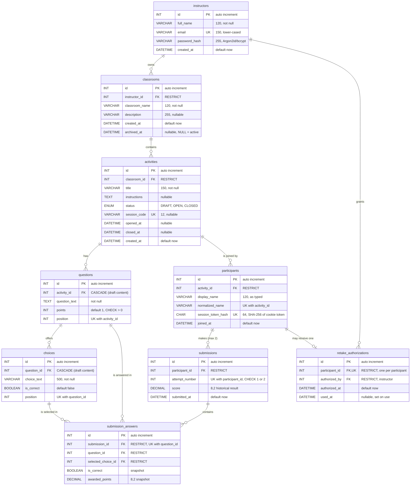

# Phase 1 Design: Architecture and Database

Offline Classroom Polling System. This document covers the system architecture, the normalized MySQL design, every key / constraint / index, the design decisions taken where the specification left room, and the ERD.

## 1. System architecture

### 1.1 Runtime topology (LAN, no internet needed)

```
 Instructor browser ─┐
 Student phones      ─┼── Wi-Fi router (LAN) ──►  Host computer
 Student laptops     ─┘                           ├─ Next.js 16 app (Node.js)  :3000
                                                  │    pages + Route Handlers + services
                                                  └─ MySQL 8.4 (InnoDB)        :3306  (localhost only)
```

- One Next.js application serves both the UI and the API.
- MySQL listens on `localhost` only. Browsers never connect to it; every query runs server-side through Prisma.
- Students open `http://<host-LAN-IP>:3000`. No internet connection is needed once installed.

### 1.2 Layers

| # | Layer | Contents | Rule |
|---|---|---|---|
| 1 | Presentation | React pages, forms, tables, dialogs, student activity UI | No business logic, no database access |
| 2 | API | Next.js Route Handlers (GET / POST / PATCH / DELETE) | Validate input (Zod), authenticate, call a service, map errors to HTTP codes |
| 3 | Business logic | `src/services/*.service.ts`, `src/lib/{auth,session,session-code,scoring,validation,pdf}.ts` | Ownership checks, session codes, scoring, retakes. The only place rules live |
| 4 | Data access | Prisma Client (`src/lib/prisma.ts`), transactions | Server-only. One shared client |
| 5 | Database | MySQL 8.4, `offline_polling_db` | Constraints are the last line of defence |

Principle: a rule is enforced in the service layer AND, wherever MySQL can express it, by the database too (unique keys, foreign keys, CHECK constraints). The service gives friendly errors; the database guarantees integrity even under simultaneous requests.

### 1.3 Folder structure added in Phase 1

```
prisma/schema.prisma            Prisma schema (9 tables)
prisma/check-constraints.sql    CHECK constraints (appended to the init migration)
prisma/migrations/              generated by Prisma
prisma.config.ts                Prisma CLI config (URLs)
src/lib/prisma.ts               PrismaClient singleton (driver adapter)
src/generated/prisma/           generated client (git-ignored)
scripts/mysql-setup.sql         creates databases + app user
scripts/append-checks.mjs       adds CHECKs to the init migration
scripts/verify-phase1.ts        structure / CRUD / constraint verification
```

## 2. Database design

Database `offline_polling_db`, InnoDB, `utf8mb4` / `utf8mb4_0900_ai_ci`.

### 2.1 Tables

| Table | Purpose | Notes |
|---|---|---|
| `instructors` | Instructor accounts | `email` unique, stored lower-cased; `password_hash` only |
| `classrooms` | Classrooms owned by an instructor | Archived via `archived_at`, never deleted |
| `activities` | Polling activities | `status` DRAFT / OPEN / CLOSED; `session_code` assigned at open |
| `questions` | Questions of an activity | `position` orders display; `points > 0` |
| `choices` | Answer options of a question | `is_correct` never sent to students |
| `participants` | Students who joined an activity | No accounts; token hash identifies the browser session |
| `submissions` | One row per attempt | `attempt_number` 1 or 2; `score` is a historical value |
| `submission_answers` | One row per answered question per attempt | `is_correct`, `awarded_points` are snapshots |
| `retake_authorizations` | Instructor-approved second attempt | One per participant; `used_at` makes it single-use |

### 2.2 Normalization (target: 3NF)

- **1NF**: every column holds one atomic value; choices and answers are rows, never comma-separated lists; every table has a primary key.
- **2NF**: every table has a single-column surrogate key (`id`), so partial dependencies cannot occur. The composite candidate keys (`submission_id + question_id`, `participant_id + attempt_number`, `activity_id + position`, ...) are enforced as unique constraints, and every non-key column depends on the whole key.
- **3NF**: each fact lives in exactly one place. Instructor data only in `instructors`; classroom name only in `classrooms`; activity data only in `activities`; question text only in `questions`; choice text only in `choices`; a student's selected answer only in `submission_answers`. No table stores a value that is determined by a non-key column of the same table, with the three deliberate exceptions below.

**Deliberate, documented exceptions** (stored derived values):

1. `submissions.score`: derivable from `submission_answers`, stored because the specification requires a historical result that is never recomputed.
2. `submission_answers.is_correct` / `awarded_points`: a snapshot of correctness at submission time, for the same reason.
3. `participants.normalized_name`: derivable from `display_name`, stored so MySQL can enforce "no duplicate join" with a unique key, which is race-safe where an application-level check is not.

### 2.3 Primary keys

Every table: `id INT AUTO_INCREMENT PRIMARY KEY`.

### 2.4 Foreign keys and delete behaviour

| # | Child column | Parent | ON DELETE | Why |
|---|---|---|---|---|
| 1 | `classrooms.instructor_id` | `instructors.id` | RESTRICT | An instructor with classrooms cannot be deleted |
| 2 | `activities.classroom_id` | `classrooms.id` | RESTRICT | Archive classrooms instead of deleting |
| 3 | `questions.activity_id` | `activities.id` | **CASCADE** | Questions are draft content of an activity |
| 4 | `choices.question_id` | `questions.id` | **CASCADE** | Deleting a draft question removes its choices |
| 5 | `participants.activity_id` | `activities.id` | RESTRICT | Participation is history |
| 6 | `submissions.participant_id` | `participants.id` | RESTRICT | Submissions are history |
| 7 | `submission_answers.submission_id` | `submissions.id` | RESTRICT | Answers are history |
| 8 | `submission_answers.question_id` | `questions.id` | RESTRICT | A question that was answered cannot be deleted |
| 9 | `submission_answers.selected_choice_id` | `choices.id` | RESTRICT | A choice that was selected cannot be deleted |
| 10 | `retake_authorizations.participant_id` | `participants.id` | RESTRICT | Audit trail |
| 11 | `retake_authorizations.authorized_by` | `instructors.id` | RESTRICT | Audit trail |

The two CASCADE rules cannot destroy history: rows 8 and 9 (and 5) are RESTRICT, so MySQL refuses a cascading delete that would reach an answered question or choice, and refuses it atomically (nothing is partially deleted). `ON UPDATE CASCADE` everywhere (ids never change in practice).

### 2.5 Unique constraints

| Table | Columns | Enforces |
|---|---|---|
| `instructors` | `email` | One account per e-mail (case-insensitive collation as a second safety net) |
| `activities` | `session_code` | A code is never reused; NULL allowed for drafts |
| `questions` | `activity_id, position` | No two questions at the same position |
| `choices` | `question_id, position` | No two choices at the same position |
| `participants` | `activity_id, normalized_name` | No duplicate join by name in one activity |
| `participants` | `session_token_hash` | A session token identifies one participant |
| `submissions` | `participant_id, attempt_number` | At most one submission per attempt number |
| `submission_answers` | `submission_id, question_id` | One answer per question per submission |
| `retake_authorizations` | `participant_id` | At most one retake per participant |

### 2.6 CHECK constraints (`prisma/check-constraints.sql`)

| Constraint | Rule |
|---|---|
| `chk_questions_points_positive` | `points > 0` |
| `chk_questions_position_positive` | `position >= 1` |
| `chk_choices_position_positive` | `position >= 1` |
| `chk_submissions_attempt_number` | `attempt_number IN (1, 2)` |
| `chk_submissions_score_nonneg` | `score >= 0` |
| `chk_submission_answers_points_nonneg` | `awarded_points >= 0` |
| `chk_activities_lifecycle` | DRAFT: no code, no timestamps. OPEN: code + `opened_at`, no `closed_at`. CLOSED: code + both timestamps |

### 2.7 Indexes

Every foreign-key column is covered by an explicit index (so MySQL never creates hidden, unnamed ones):

| Index | Serves |
|---|---|
| `classrooms (instructor_id, archived_at)` | FK 1 + "my active classrooms" |
| `activities (classroom_id, status)` | FK 2 + "activities of a classroom by status" |
| `questions` unique `(activity_id, position)` | FK 3 + ordered question list |
| `choices` unique `(question_id, position)` | FK 4 + ordered choice list |
| `participants` unique `(activity_id, normalized_name)` | FK 5 + participant list |
| `submissions` unique `(participant_id, attempt_number)` | FK 6 + attempt history |
| `submission_answers` unique `(submission_id, question_id)` | FK 7 |
| `submission_answers (question_id)` | FK 8 |
| `submission_answers (selected_choice_id)` | FK 9 |
| `retake_authorizations` unique `(participant_id)` | FK 10 |
| `retake_authorizations (authorized_by)` | FK 11 |

Plus the unique indexes on `instructors.email`, `activities.session_code`, `participants.session_token_hash`. Total: 9 primary keys, 11 foreign keys, 9 unique constraints, 3 secondary indexes, 7 CHECK constraints.

### 2.8 Rules the database cannot express (service layer, Phase 4 and later)

MySQL has no declarative way to say "at least N child rows" or "exactly one child row has a flag". These are enforced in the service layer, inside a transaction, before an activity is opened:

- at least one question per activity;
- at least two choices per question;
- exactly one `is_correct = true` choice per question;
- the selected choice belongs to the answered question, and the question belongs to the participant's activity.

## 3. Decisions and deviations from the specification

| # | Decision | Reason |
|---|---|---|
| D1 | **Prisma 7 (pinned), not Prisma 8** | `npm install prisma` now installs a Prisma 8 release candidate whose MySQL support is an early preview that cannot write rows. Prisma 7 is the stable line that supports MySQL |
| D2 | `participants` gets two extra columns: `normalized_name`, `session_token_hash` | §4.6 requires duplicate prevention by normalized name; §6 requires an unpredictable participant token bound to the participant and activity. Both need storage; adding columns keeps the nine-table structure |
| D3 | No `student_id` column | §1.1 mentions "full name and student id", but §4.6 and §8 specify name + session code only, and §4.6 says not to collect unnecessary personal data. **Please confirm**; adding it later is one migration |
| D4 | Session code is kept after an activity closes; "deactivated" means `status = CLOSED` | Preserves the historical record; global uniqueness means codes are never reused. Enforced by `chk_activities_lifecycle` |
| D5 | An unanswered question has no `submission_answers` row (awards 0) | `selected_choice_id` is NOT NULL per §4.8. Maximum score is computed from `questions`, not from answers |
| D6 | Case- and accent-insensitive collation `utf8mb4_0900_ai_ci` | MySQL default. Consequence: "Jose" and "JOSÉ" count as the same name in one activity |
| D7 | `DATETIME` (seconds precision), stored in UTC by Prisma | Matches §4 (`DATETIME`); ordering of attempts uses `attempt_number`, not time |
| D8 | Positions may have gaps and are unique per parent | Add/delete are supported without renumbering; a future "reorder" feature must swap inside a transaction |

## 4. Entity-relationship diagram

Also available as `docs/erd.mmd` (source) and `docs/erd.png` (rendered).



### Relationships

| Relationship | Cardinality | Meaning |
|---|---|---|
| instructors → classrooms | 1 : many | An instructor owns many classrooms; each classroom has exactly one owner |
| classrooms → activities | 1 : many | A classroom holds many activities |
| activities → questions | 1 : many | An activity has many questions (at least one before it can open) |
| questions → choices | 1 : many | A question has many choices (at least two, exactly one correct) |
| activities → participants | 1 : many | Students join one activity; there is no cross-activity identity |
| participants → submissions | 1 : 0..2 | One normal attempt plus at most one authorised retake |
| submissions → submission_answers | 1 : many | One answer row per answered question |
| questions → submission_answers | 1 : many | Which question each answer belongs to |
| choices → submission_answers | 1 : many | Which choice was selected |
| participants → retake_authorizations | 1 : 0..1 | At most one retake per participant |
| instructors → retake_authorizations | 1 : many | Who granted each retake |
